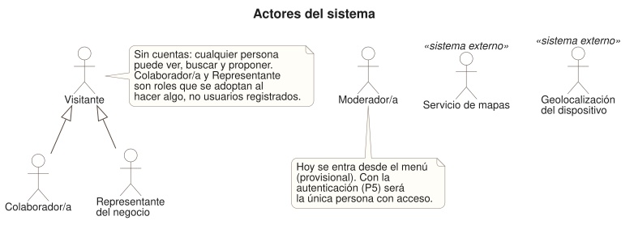
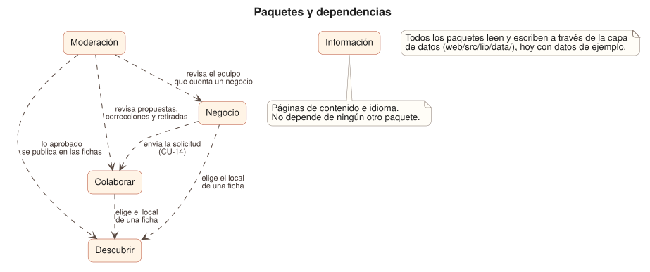
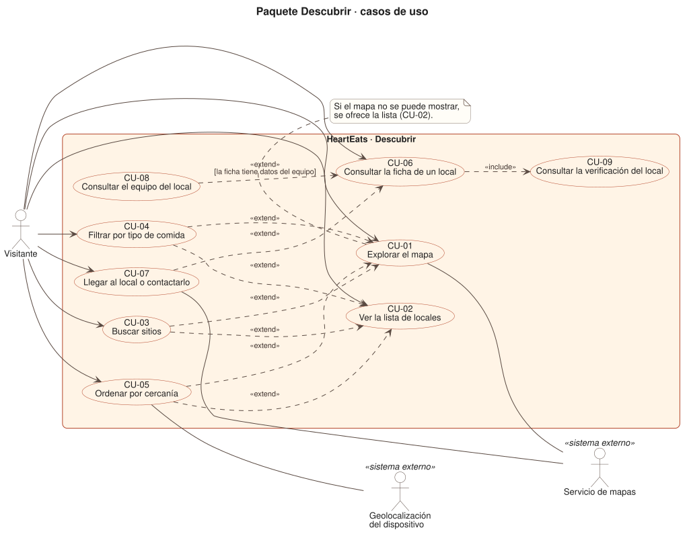
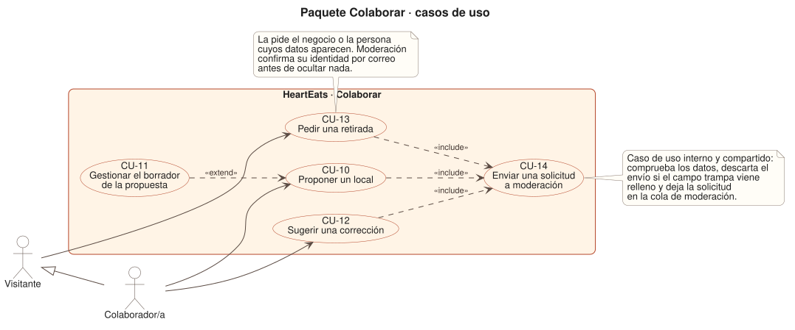
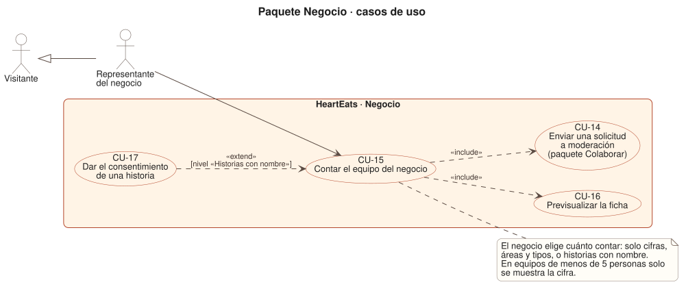
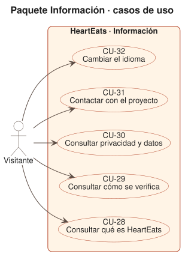

# 10 · Casos de uso

> **Estado:** borrador v0.5 · versión compacta. Complementa a `04_DISENO_UI.md` (pantallas) y a `07_VERIFICACION.md` (moderación).

## 1. Para qué sirve

Es el mapa de **qué hace HeartEats y para quién**: 34 casos de uso (CU), sus actores y cómo se relacionan. El detalle de cada uno está en las [fichas](casos-de-uso/README.md); el ciclo de una propuesta, los estados y los datos, en [`11_FLUJO_Y_DOMINIO.md`](11_FLUJO_Y_DOMINIO.md).

**Cómo leer los diagramas:** un óvalo es un CU y un muñeco, un actor. `«include»`: el origen **siempre** usa al destino. `«extend»`: **a veces** lo amplía. Gris: pendiente.

**Estado de cada CU:** *Hecho* (pantalla terminada, con datos de ejemplo), *Hecho (envío simulado)* (lo enviado solo llega al buzón de prueba del navegador; con servidor llegará de verdad) o *Pendiente*.

## 2. Actores



| Actor | Quién es |
|---|---|
| **Visitante** | Cualquiera. Ve, busca y consulta sin registrarse. |
| **Colaborador/a** | Visitante que propone o corrige. Es un papel, no un usuario registrado. |
| **Representante del negocio** | Visitante que habla por un local: cuenta su equipo y consiente. Moderación lo confirma por correo. |
| **Moderador/a** | Revisa y decide. Al inicio, Marlon. Hoy se entra desde el menú (provisional, hasta P5). |
| **Servicio de mapas** y **Geolocalización** | Externos: el mapa y la posición («Cerca de mí», solo si se pulsa). |

Quien pide una retirada (CU-13) es un Visitante: el negocio o la persona cuyos datos aparecen.

## 3. Paquetes



| Paquete | Qué agrupa | CU |
|---|---|---|
| **Descubrir** | Encontrar un sitio y ver su ficha | CU-01 a CU-09 |
| **Colaborar** | Proponer, corregir, pedir retirada y el envío común | CU-10 a CU-14 |
| **Negocio** | El negocio cuenta su equipo y consiente | CU-15 a CU-17 |
| **Moderación** | Revisar y decidir | CU-18 a CU-27, CU-33, CU-34 |
| **Información** | Páginas de contenido e idioma | CU-28 a CU-32 |

`A ⇢ B` significa «A necesita a B». Lo aprobado en Moderación acaba en las fichas de Descubrir, pero Descubrir no sabe nada de Moderación.

## 4. Casos de uso por paquete

### 4.1 Descubrir

Fichas: [descubrir](casos-de-uso/descubrir.md).



| ID | Caso de uso | Actor | Estado |
|---|---|---|---|
| CU-01 | Explorar el mapa | Visitante; Servicio de mapas | Hecho |
| CU-02 | Ver la lista de locales | Visitante | Hecho |
| CU-03 | Buscar sitios | Visitante | Hecho |
| CU-04 | Filtrar por tipo de comida | Visitante | Hecho |
| CU-05 | Ordenar por cercanía | Visitante; Geolocalización | Hecho |
| CU-06 | Consultar la ficha de un local | Visitante | Hecho |
| CU-07 | Llegar al local o contactarlo | Visitante; Servicio de mapas | Hecho |
| CU-08 | Consultar el equipo del local | Visitante | Hecho |
| CU-09 | Consultar la verificación del local | Visitante | Hecho |

### 4.2 Colaborar

Fichas: [colaborar](casos-de-uso/colaborar.md).



| ID | Caso de uso | Actor | Estado |
|---|---|---|---|
| CU-10 | Proponer un local | Colaborador/a | Hecho (envío simulado) |
| CU-11 | Gestionar el borrador de la propuesta | Colaborador/a | Hecho |
| CU-12 | Sugerir una corrección | Colaborador/a | Hecho (envío simulado) |
| CU-13 | Pedir una retirada | Visitante | Hecho (envío simulado) |
| CU-14 | Enviar una solicitud a moderación | *(interno)* | Hecho (envío simulado) |

### 4.3 Negocio

Fichas: [negocio](casos-de-uso/negocio.md).



| ID | Caso de uso | Actor | Estado |
|---|---|---|---|
| CU-15 | Contar el equipo del negocio | Representante del negocio | Hecho (envío simulado) |
| CU-16 | Previsualizar la ficha | Representante del negocio | Hecho |
| CU-17 | Dar el consentimiento de una historia | Representante del negocio | Hecho |

### 4.4 Moderación

Fichas: [moderacion](casos-de-uso/moderacion.md).


| ID | Caso de uso | Actor | Estado |
|---|---|---|---|
| CU-18 | Consultar la cola de solicitudes | Moderador/a | Hecho (datos de ejemplo) |
| CU-19 | Revisar una solicitud | Moderador/a | Hecho |
| CU-20 | Revisar la propuesta de un local | Moderador/a | Hecho |
| CU-21 | Revisar una corrección | Moderador/a | Hecho |
| CU-22 | Revisar el equipo de un negocio | Moderador/a | Hecho |
| CU-23 | Revisar una petición de retirada | Moderador/a | Hecho |
| CU-24 | Aprobar y publicar | Moderador/a | Hecho (decisión simulada) |
| CU-25 | Rechazar con motivo | Moderador/a | Hecho (decisión simulada) |
| CU-26 | Pedir más información | Moderador/a | Hecho (decisión simulada) |
| CU-27 | Registrar la acción en la auditoría | *(interno)* | Hecho (se muestra en el detalle; el registro real llega con el servidor) |
| CU-33 | Autenticarse (enlace mágico) | Moderador/a | **Pendiente** (decisión P5) |
| CU-34 | Revisar fichas sin actualizar | Moderador/a | **Pendiente** |

### 4.5 Información

Fichas: [informacion](casos-de-uso/informacion.md).



| ID | Caso de uso | Actor | Estado |
|---|---|---|---|
| CU-28 | Consultar qué es HeartEats | Visitante | Hecho |
| CU-29 | Consultar cómo se verifica | Visitante | Hecho |
| CU-30 | Consultar privacidad y datos | Visitante | Hecho |
| CU-31 | Contactar con el proyecto | Visitante | Hecho |
| CU-32 | Cambiar el idioma | Visitante | Hecho |

## 5. Qué nos dice el modelo

- **Cobertura del front:** 32 de los 34 CU tienen ya su pantalla. Los dos pendientes (CU-33 y CU-34) dependen de decisiones de backend o de un flujo aún por diseñar.
- **Lo «simulado» es una sola cosa:** el envío (CU-14) y la decisión (CU-24 a CU-27). Con servidor se cambia en `web/src/lib/data/` y las pantallas no se tocan.
- **Un único punto de entrada** (CU-14) para cuatro flujos: el lugar natural del límite de envíos y de la validación en servidor.

## 6. Decisiones abiertas

Candidatas a hoja de ruta, **no son decisiones**. El detalle está en las observaciones de cada ficha.

**De producto**
- ¿Cómo aporta un negocio la foto y los platos de su local? Hoy no hay ningún flujo.
- «Info pedida» cierra la solicitud: qué pasa al responder (ver `11_FLUJO_Y_DOMINIO.md`).
- El plato estrella no es obligatorio al proponer, pero la ficha lo da por supuesto.
- La lista de motivos de rechazo es la misma para todos los tipos.
- Las fichas de más de 12 meses solo se marcan; nada las trata (CU-34).

**Antes de abrir al público**
- Faltan el aviso legal y la política de cookies y almacenamiento.
- Con servidor se recibirán por primera vez datos personales de terceros (nombres, historias): revisión legal, plazos reales y seguridad.
- El consentimiento de una historia no deja constancia verificable, y Moderación no ve el texto.
- El registro de auditoría no tiene persona ni hora.
- Cualquiera puede decir que es del negocio: hay que definir cómo se confirma (P9).

## 7. Regenerar los diagramas

Requiere PlantUML y Graphviz (`brew install plantuml graphviz`). Después:

```bash
docs/modelado/render.sh
```

Los `.puml` son la fuente; los `.svg` se versionan para que se vean en GitHub y en el móvil.
