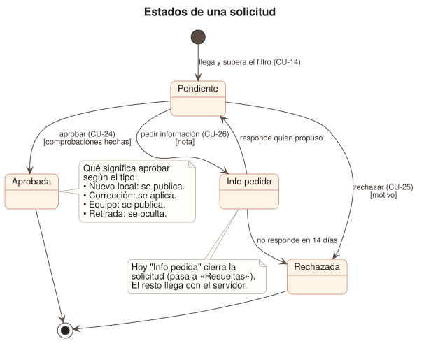

# 11 · Flujo y dominio

> **Estado:** borrador v0.1 · tres diagramas que completan [`10_CASOS_DE_USO.md`](10_CASOS_DE_USO.md): cómo avanza una propuesta, en qué estados puede estar una solicitud y qué datos maneja la web. Pensado para leerse en cinco minutos.

## 1. Cómo avanza una propuesta

Los mismos pasos, en texto:

1. El Colaborador/a propone un local ([CU-10](casos-de-uso/colaborar.md#cu-10--proponer-un-local)).
2. El Sistema lo valida y lo envía ([CU-14](casos-de-uso/colaborar.md#cu-14--enviar-una-solicitud-a-moderación)). Si el campo trampa viene relleno, lo descarta en silencio; si no, lo deja en la cola con sus avisos (duplicado, cadena, sin pruebas).
3. El Moderador/a lo revisa ([CU-20](casos-de-uso/moderacion.md#cu-20--revisar-la-propuesta-de-un-local)) y contacta con el negocio **fuera de la web**.
4. El negocio confirma que quiere aparecer.
5. El Moderador/a decide: rechazar ([CU-25](casos-de-uso/moderacion.md#cu-25--rechazar-con-motivo)), pedir más información ([CU-26](casos-de-uso/moderacion.md#cu-26--pedir-más-información)) o aprobar ([CU-24](casos-de-uso/moderacion.md#cu-24--aprobar-y-publicar)).
6. El Sistema lo deja en la auditoría ([CU-27](casos-de-uso/moderacion.md#cu-27--registrar-la-acción-en-la-auditoría)) y, si se aprobó, publica la ficha.
7. Después, si quiere, el negocio cuenta su equipo ([CU-15](casos-de-uso/negocio.md#cu-15--contar-el-equipo-del-negocio)), que entra por el mismo circuito.

Este es el ciclo de un **local nuevo**. Una corrección, un equipo y una retirada siguen el mismo camino con sus propias comprobaciones.

## 2. Estados de una solicitud

| Estado | Significa | Hoy |
|---|---|---|
| **Pendiente** | Espera revisión. | Hecho |
| **Aprobada** | Se publica, se aplica o se oculta, según el tipo. | Simulado |
| **Rechazada** | Descartada con motivo. | Simulado |
| **Info pedida** | Moderación necesita saber más. | Cierra la solicitud |

**Decisión abierta.** Hoy «Info pedida» manda la solicitud a «Resueltas», igual que rechazarla. Con el servidor hay que elegir:

- **A (recomendada):** una solicitud con info pedida **vuelve a Pendiente** cuando quien propuso responde, y **se cierra** sola si no responde en un plazo. Mantiene todo el historial en una sola solicitud.
- **B:** es un final, y quien responde envía una solicitud nueva. Más simple de construir, pero se pierde el hilo.

Con A se necesita decidir el plazo (por ejemplo, 14 días, que es el que `07_VERIFICACION.md` propone para responder) y cómo responde quien propone, que no tiene cuenta (p. ej. un enlace en el correo).

## 3. Qué datos maneja la web

| Concepto | Qué es | Dónde vive hoy |
|---|---|---|
| **Restaurante** | Un local publicado. | `lib/types.ts` (`Restaurant`), datos de ejemplo |
| **Plato estrella** | De 1 a 3 por local. | `SignatureDish` |
| **Verificación** | Nivel, método, fecha y si necesita revisión. | `Restaurant.verification` |
| **Equipo** | Lo que el negocio cuenta, en tres niveles. | `Team` |
| **Historia** | Con el permiso de cada persona; hasta 3. | `TeamStory` |
| **Solicitud** | Algo que llega y espera decisión: nuevo, corrección, equipo o retirada. | `ModerationItem`, en el buzón de prueba del navegador |
| **Decisión** | Aprobar, rechazar o pedir información. | `ModerationDecision`, sin guardar |
| **Registro de auditoría** | Quién, qué y cuándo. | No existe aún |

**A alinear con la especificación de datos.** `01_ESPECIFICACION_DATOS.md` define la solicitud (`Suggestion`) con dos tipos, `new` y `edit`, y tres estados, `pending`, `approved` y `rejected`. La web ya trabaja con **cuatro tipos** (nuevo, corrección, equipo y retirada) y **un estado más** (info pedida). Cuando se cierre la decisión de §2, hay que actualizar esa especificación antes de escribir el servidor.
